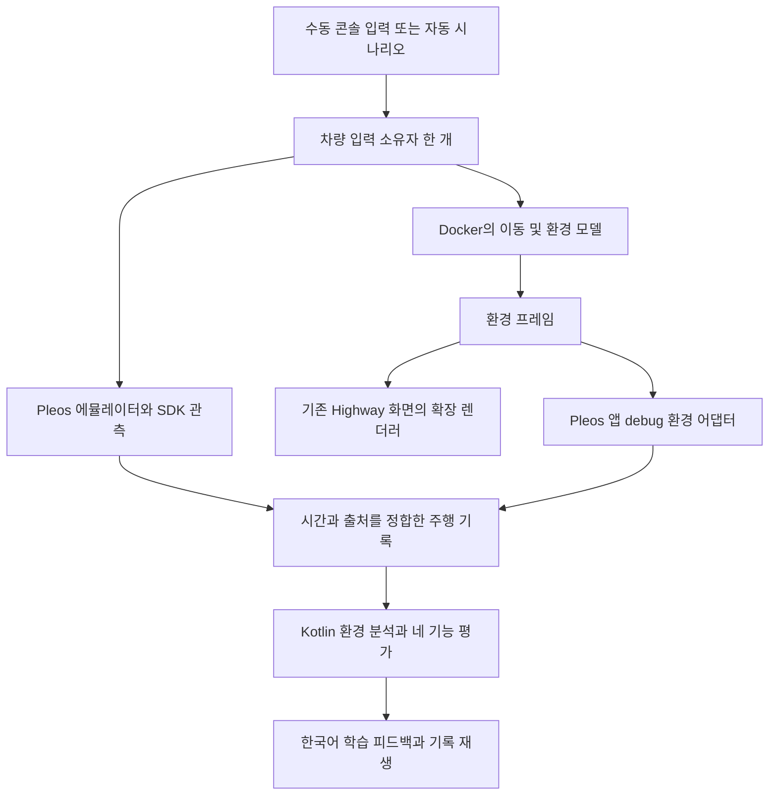

# 가상 주행 환경과 네 가지 평가 기능 구현 계획

Virtual Console 확장을 통해 차로 변경, 차로 유지, 신호등 대응, 차간거리의 검출과 학습 평가를 구현한다. 초기 목표는 **직선 3차로와 직진 신호가 있는 고정 시나리오를 에뮬레이터에서 시연하고 자동 재생으로 검증하는 것**이다. 절대 GPS나 실도로 지도 없이도 이 범위의 환경을 구성할 수 있다.

현재 원본 콘솔 프록시, 독립 이동 모델, Kotlin 환경 평가기, 공유 계약 생성, SDK 단조 시각 대응, 종합 보고서·학습 피드백·전체 기록 재생 연결을 구현했다. 아래 내용은 목표 설계이며, 화면 일치·조향 부호 검증과 전체 경계 시나리오 확대는 남아 있다. 시뮬레이션 환경을 사용하는 평가 결과에는 해당 출처를 표시하며, 실차의 차선·신호·차량을 인식하는 기능은 별도 공급자가 필요하다.

## 현재 구현과 추가할 입력

| 기능 | 현재 확보한 기반 | 추가할 입력과 모델 | 초기 구현 결과 |
|---|---|---|---|
| 차로 변경 | 차선의 고정 기하, 자차의 화면 횡위치, SDK 조향·속도·방향지시등 | 누적 횡이동·자세, 차체 크기, 안정적인 차로 ID와 인접 관계 | 좌우 변경의 시작·경계 통과·완료·중간 복귀와 신호 사용 복습 |
| 차로 유지 | 차로 폭 3.7m와 경계 좌표 | 차체와 경계 사이 여유, 차로 진행 방향 대비 자세, 변경 구간 | 경계 접근·침범 지속시간, 좌우 흔들림, 차로 안에서 안정된 주행 구간 |
| 신호등 대응 | 기존 속도·제동 입력 | 적용 차로·진행 방향이 있는 신호, 단계 변화, 정지선, 자차 앞 범퍼 위치 | 접근 중 감속·정차, 정지선 통과 시점과 당시 신호 관측 |
| 차간거리 | 주변 차량의 화면 좌표 | 같은 차로 선행차, 안정적인 객체 ID, 차체 치수, 속도·상대속도 | 범퍼 간 거리, 시간 간격, 접근 중 충돌 예상 시간과 짧은 간격의 지속 구간 |

원본 `CONSOLE_VISUALIZATION`의 조향 반응은 자차 x를 최대 ±1.15m로 움직이는 시각 효과다. 원본 화면 좌표인 버전 1 관측은 평가 근거로 쓰지 않는다. 새 버전 2 모델은 누적 위치·중앙 선행차·신호·정지선을 생성하며 확장 화면과 별도 평가기에 제공한다. 원본 좌표만 전달하는 상태와 새 모델의 검증 범위를 구분한다.

## 환경 모델과 평가 엔진의 역할

환경 모델이 자차·차로·주변 차량·신호·정지선을 관리한다. 화면과 앱은 같은 프레임을 소비한다. 시뮬레이터에는 위치와 신호 상태를 넣고, 차로 변경 성공이나 위험한 간격 같은 최종 판정은 넣지 않는다. 판정은 Kotlin 평가 엔진에서 계산한다.

수동 시연은 기존 콘솔이 차량 속성 쓰기를 담당하고 자동 시연은 테스트 실행기가 담당한다. 두 모드를 동시에 실행하지 않는다. 환경 모델은 입력을 읽고 장면을 계산하며, 또 다른 속도·브레이크 제어 루프를 만들지 않는다. 명령 전송·응답 시각과 SDK 관측 시각을 기록해 불일치를 검출한다. 공급자가 실제 반영 시각을 제공하지 않으면 이를 추정 시각과 구분한다.

자동 시연 화면을 함께 열려면 차량 속성 쓰기와 제어 세션 등록을 하지 않는 관찰 모드를 먼저 추가해야 한다. 현재 확장 콘솔은 원본의 쓰기 루프를 유지하므로 기존 자동 테스트에서는 계속 콘솔 탭을 닫는다.

## 공통 환경 계약과 시간

공유 계약은 `packages/contracts`에서 관리하고 TypeScript와 Kotlin이 같은 스키마를 사용한다. 초기 POST 프레임은 화면 관측용이므로 평가용 계약을 추가할 때 버전을 구분한다.

| 필드 그룹 | 필요한 내용 |
|---|---|
| 식별 | 계약 버전, 시나리오 실행 ID, 환경 모델 버전, 프레임 순번 |
| 시간 | 단조 증가하는 시뮬레이션 시각, 생성·수신 시각, 유효기간, 정지 상태 |
| 출처와 품질 | 채널별 SDK/시뮬레이션 구분, 사용 가능 여부, 단절·제외 사유 |
| 자차 | 도로 내 위치·자세·차체 치수, 모델에 사용한 속도·조향의 입력 ID와 시각 |
| 도로 | 차로 ID·연결 관계·폭·경계 형상·경계 종류·진행 방향 |
| 객체 | 생애주기가 있는 ID, 위치·자세·치수·속도, 관측 영역의 유효 여부 |
| 신호 | 신호 ID, 적용 차로와 진행 방향, 현재 단계, 단계 변경 시각, 연결된 정지선 |

시뮬레이션의 도로 좌표는 전방 진행 거리 `s`, 도로 왼쪽이 양수인 횡위치 `d`로 통일한다. 앱에 전달하는 상대 위치도 전방 거리와 왼쪽 거리로 정의한다. 기존 Three.js 좌표와 SDK 조향 부호는 어댑터에서 변환하고 좌우 시나리오로 검증한다. 최초 범위는 직선 도로이며, 커브를 추가할 때는 중심선과 그 국소 방향에 따라 상대 좌표를 계산한다.

엔진 `Observation.atMs`는 하나의 단조 세션 시계를 사용한다. 현재 브라우저의 `capturedAtMs = Date.now()`는 UTC이므로 그대로 대입하지 않는다. 환경 시각과 앱의 `SystemClock.elapsedRealtime()` 사이 대응과 오차를 기록한다. 시간 오차가 큰 구간에서는 신호 변경 직전·직후 같은 경계 판정을 보류한다.

앱이 같은 최신 프레임을 여러 번 조회해도 순번으로 중복을 제거한다. 재수신 시각으로 오래된 프레임의 유효기간을 연장하지 않는다. 누락·역순·시나리오 재시작·시간 점프에서는 진행 중인 행동을 끊고 새 구간을 시작한다. 데이터가 없는 구간을 가로질러 차로 변경이나 정지선 통과를 완료 처리하지 않는다.

관측 결과는 `관측됨`, `유효한 관측 영역에 대상 없음`, `관측 불가`를 구분한다. 앞차 배열이 비었어도 관측 영역이 무효하면 앞차가 없다고 판단하지 않는다. 현재 수신 후 1.5초 만료는 연결 상태 확인용이며, 각 평가기의 허용 간격·최대 지연은 별도로 설정한다.

## 자차 이동과 장면 구성

Docker의 환경 모듈이 렌더링과 독립된 고정 간격으로 상태를 갱신한다. 초기 제안은 50ms 간격 계산이며, 기록 재생도 같은 간격과 입력 순서를 사용한다. 난수 사용 시 seed를 기록한다. 실행이 지연되면 긴 시간을 한 번에 적분하지 않고 단절이나 명시적 일시정지로 처리한다.

자차는 속도와 조향을 이용한 단순한 bicycle model로 이동시킨다. 핸들 회전각을 전륜 조향각으로 바꾸는 조향비, 축거, 차체 크기는 시뮬레이션 설정으로 둔다. 내부 위치 기준은 후륜축 중심이다. 직선 도로에서 `전방 변화율 = 속도 × cos(자세)`, `횡방향 변화율 = 속도 × sin(자세)`, `자세 변화율 = 속도 / 축거 × tan(전륜 조향각)`을 적분한다. 속도는 m/s, 길이는 m, 각도는 rad, 적분 간격은 초로 통일한다. 입력 속도를 후륜축 속도로 근사하는 저속 모델이며 타이어 미끄럼이나 고속 한계 거동까지 재현한다고 가정하지 않는다.

환경 계약의 자차 위치는 차체 중심으로 전달하고 기준점을 명시한다. 내부 후륜축 위치에서 차체 중심까지의 오프셋을 자세에 따라 회전해 변환한다. 차체 다각형과 앞 범퍼도 같은 치수·오프셋으로 구해 차간거리와 정지선 거리의 기준이 어긋나지 않게 한다.

처음에는 3차로·차로 폭 3.7m를 유지한다. 중앙 선행차, 옆 차로 차량, 끼어들 차량을 독립적으로 배치하고 가감속 궤적을 준다. 객체가 장면 끝에서 재생성되면 새 ID를 부여해 순간 이동을 실제 상대속도로 계산하지 않는다. 신호와 정지선도 같은 도로 좌표에 둔다.

화면은 환경 모델의 자차와 주변 차량 좌표를 그리도록 수정하고 원본의 별도 횡이동·차량 이동 계산을 교체한다. 브라우저 탭이 숨겨져도 모델 시간은 렌더링에 종속되지 않는다. 수동 시연의 입력 브리지가 중단되면 환경도 일시정지 또는 관측 불가로 바뀌어야 한다. 자동 시연은 브라우저 없이 계속 실행할 수 있게 한다.

## 차로 변경 검출과 신호 사용

차로 변경 검출은 `원래 차로에서 안정 → 경계 접근 → 차체의 경계 통과 → 인접 차로에서 안정`의 상태 기계로 구현한다. 차로 ID를 매 프레임 가장 가까운 중심선으로 바꾸지 않고, 원래 차로와 목표 차로를 유지하면서 차체 전체가 목표 차로 안에 들어왔는지 확인한다. 안정 시간과 경계 여유는 실험 설정으로 관리한다.

중간에 원래 차로로 돌아오면 변경 시도 후 복귀로 기록한다. 여러 차로를 연속해서 가로지른 경우와 차체 일부만 경계를 밟은 경우를 단일 차로 변경 완료와 구분한다. 순간 이동·관측 공백·후진·지원하지 않는 교차로 구간은 완료 판정을 보류한다.

방향지시등을 켰는지는 변경 검출 조건에 넣지 않는다. 변경을 검출한 뒤 관측된 방향지시등 선택 상태와 비교해 미사용·늦은 사용·반대 방향·중간 해제를 복습 항목으로 만든다. 비상등 상태가 확인되지 않는 구간에서는 기존 정책대로 신호 사용의 확정 평가를 보류한다.

차로 변경은 별도 `LaneChangeManeuver`로 표현한다. 기존 `TurnManeuver`는 도로 전환과 헤딩 변화가 필요한 회전 계약이므로 여기에 변경을 끼워 넣지 않는다. 현재 위치 기반 `LANE_CHANGE_*_CANDIDATE`와 같은 시간에 검출되면 근거가 있는 환경 기반 결과와 연결해 피드백 중복을 막는다.

## 차로 유지 평가

차체의 위치·자세·길이·폭으로 바닥면 다각형을 만들고 좌우 차선 경계와의 여유를 계산한다. 중심선 오차뿐 아니라 최소 여유, 경계 침범 지속시간, 좌우 이동의 반복을 측정한다. 실험 설정의 경계 접근·침범 조건에는 지속시간과 복귀 여유를 둬 작은 흔들림으로 이벤트가 반복 생성되지 않게 한다.

차로 변경 중의 경계 통과는 차로 유지 이탈로 중복 집계하지 않는다. 방향지시등 OFF만으로 부주의한 이탈이라고 단정하지 않고, `경계 통과 관측`과 `확인된 차로 변경`을 분리한다. 저속 조작·후진·곡선 도로의 지원 여부도 평가 가능 구간에 반영한다.

학습 피드백은 ‘오른쪽 경계에 가까운 상태가 이어졌어요’, ‘차로 안에서 좌우 이동이 반복됐어요’처럼 관측을 설명한다. 조향 횟수만으로 차로 이탈을 만들거나 운전자 책임을 확정하지 않는다. 차로 유지율을 제공한다면 분모는 유효한 유지 평가 구간으로 제한하고 제외 시간을 함께 기록한다.

## 차간거리 평가

자차 앞쪽이면서 같은 차로 경로에 있는 객체를 선행차로 선택한다. 가장 가까운 객체라는 이유로 옆 차로 차량을 선택하지 않는다. 차로 변경과 끼어들기 중에는 차체의 차로 점유를 함께 보고 선행차 ID가 바뀐 이유를 기록한다.

차체 중심 간 거리에서 자차 앞 범퍼와 상대 뒤 범퍼까지의 길이를 반영해 종방향 간격을 구한다. 최초 직선·동일 방향 장면에서 계산하고, 커브에서는 도로 경로를 따른 간격을 사용하도록 확장한다.

- 시간 간격 `THW = 범퍼 간 거리 / 자차 속도`는 충분히 이동할 때 계산한다.
- 충돌 예상 시간 `TTC = 범퍼 간 거리 / 접근 상대속도`는 실제로 간격이 줄어들 때 계산한다. 초기 식은 현재 상대속도가 유지된다는 가정이다.
- 정차·멀어지는 앞차·앞차 없음·객체 중첩은 각각 별도 상태로 둔다. 0으로 나누거나 무한대를 안전 점수로 바꾸지 않는다.

짧은 시간 간격과 낮은 TTC의 지속시간을 실험 기준으로 검출한다. 앞차 ID 변경과 재생성 시 이전 대상의 상대속도 이력을 연결하지 않는다. 끼어들기로 간격이 줄어든 상황과 자차가 계속 접근한 상황은 맥락을 구분하며, 이를 곧바로 운전자 잘못이나 추돌 사고 판정으로 표시하지 않는다.

## 신호등 대응 평가

최초 범위는 직진 차로에 적용되는 적색·황색·녹색 신호 한 묶음과 정지선이다. 신호 ID는 적용 차로·진행 방향·정지선과 연결한다. 옆 차로 또는 다른 방향 신호를 자차에 적용하지 않는다. 화살표·비보호 회전·점멸 신호·신호 없는 교차로는 초기 평가 범위에서 제외한다.

`접근 → 신호 변화 관측 → 감속 또는 정차 → 정지선 통과`를 추적한다. 정차 위치는 자차 중심이 아닌 앞 범퍼 기준으로 측정한다. 정지선 전후 위치가 연속 관측된 경우 통과 시각을 추정하고, 같은 환경 시계의 신호 단계를 조회한다. 통과 시각의 오차 범위에 신호 전환이 겹치면 단정하지 않는다. 기록 시작 때 이미 정지선 뒤에 있는 차량을 새 통과로 만들지 않는다.

적색 접근 후 정지선 전에 멈춘 상황, 감속을 늦게 시작한 상황, 적색 상태에서 정지선을 통과한 관측을 구분한다. 이는 시뮬레이션의 학습 피드백이며 법규 위반 판정으로 사용하지 않는다. 황색은 진입 시점과 거리·속도를 남기는 맥락부터 구현하고 안전하게 정지할 수 있었는지의 단정은 별도 모델 검증 전까지 보류한다.

녹색에서 바로 출발하지 않아도 앞차 정차·보행자·교차로 막힘 등을 관측하지 못하면 반응 지연으로 평가하지 않는다. 초기 범위에서는 녹색 출발 지연을 감점 항목으로 만들지 않는다.

## Kotlin 엔진과 기록 연결

`DrivingSession`에 환경 관측·공백·출처를 추가하고 `EnvironmentAnalyzer`가 정합성 검사, 차로 점유와 선행차 선택, 차로 변경 검출을 수행하도록 한다. 개별 평가기는 이 분석을 소비한다. 모델이나 HTTP에 접근하는 코드는 엔진 밖의 debug 어댑터에 두어 JVM 단독 테스트를 유지한다.

현재 엔진은 배치·재생 방식이다. 우선 수집한 기록에서 네 기능의 평가를 완성하고, 시연 중 표시가 필요하면 같은 규칙을 사용하는 증분 분석을 별도 단계로 추가한다. 짧은 이동 창을 매번 새 세션처럼 평가해 진행 중 행동을 반복 완료시키지 않는다.

| 기존 연결 지점 | 변경 계획 |
|---|---|
| `DrivingEvaluationEngine.evaluate()` | 세 환경 카테고리의 고정 미평가 처리를 입력 품질에 따른 개별 평가로 교체 |
| `PracticeAnalysis`와 행동 검출 | 환경 기반 변경 결과와 기존 위치 기반 후보를 연결하고 회전과 분리 |
| `EvaluationReport` | 차로 변경 항목과 네 기능의 지표·이벤트·제외 사유·출처 추가 |
| `LearningFeedbackBuilder` | 같은 행동의 중복 피드백을 묶고 관측·연습 제안·누락 맥락 표시 |
| `TraceReplay`와 codec | 환경 원본·시각 대응·입력 연결·모델/규칙/설정 버전을 저장하고 재계산 비교 |
| 앱 debug 수집 | 환경 API 조회·프레임 중복 제거·세션 시각 변환·원본 기록 |

SDK 자차 입력과 시뮬레이션 환경을 합칠 때는 채널별 출처를 보존한다. 보고서의 전체 `LIVE` 표시만으로 실측 환경처럼 보이지 않도록 환경 평가의 시뮬레이션 출처를 별도로 표시한다. 기존 지도 기반 회전 평가에 합성 도로를 실제 지도인 것처럼 주입하지 않는다.

평가할 기회가 확인됐고 관측이 충분한 경우에만 해당 기회를 평가한다. 유효 관측에서 앞차나 신호 대상이 없었다면 기회 없음이며, 환경 데이터가 없어 기회 자체를 판단할 수 없다면 미평가다. 일부 구간만 유효하면 부분 평가와 제외 사유를 남긴다.

환경을 추가하는 새 기록 버전은 기존 0.3/0.4 재생 경로를 유지한다. 옛 기록에는 환경을 만들어 넣지 않고 해당 항목을 미평가로 남긴다. 현재 관측용 프록시의 사용 여부만으로 엔진·규칙 버전을 올리지 않으며 새 계약과 평가 구현이 준비되면 함께 갱신한다.

## 구현 순서와 완료 조건

| 순서 | 작업 | 완료 조건 |
|---|---|---|
| 1 | 공유 계약·출처·세션 시각·프레임 순번 | SDK/환경 시각을 정합하고 중복·역순·공백·재시작을 거부하는 계약 테스트 통과 |
| 2 | 독립 환경 시계·자차 이동·차로·객체 모델 | 브라우저 없이 결정론적으로 실행되고 동일 프레임으로 화면과 관측이 일치 |
| 3 | 앱 debug 환경 수집과 기록 | 에뮬레이터 앱이 환경과 SDK 입력을 함께 기록하고 원본 프레임의 출처·시각을 보존 |
| 4 | 차로 유지와 차간거리 | 안정 유지/경계 접근, 같은 차로 선행차/옆 차로 차량/끼어들기/정차를 구분 |
| 5 | 차로 변경과 신호 사용 | 좌우 완료·복귀·무신호 변경을 검출하고 유지 평가와 중복 집계하지 않음 |
| 6 | 신호·정지선과 대응 | 적색 정차/통과, 다른 차로 신호, 전환 시각 불확실을 구분 |
| 7 | 통합 시연과 전체 기록 재생 | 실제 SDK+가상 환경 기록의 평가·근거·학습 피드백이 재생 결과와 일치 |

## 자동 검증 시나리오

기대 결과는 엔진 출력에서 생성하지 않고 시나리오의 입력과 별도로 관리한다. 모델은 원시 상태만 생성하고, Kotlin 테스트는 독립적으로 작성한 경계 사례의 관측도 입력받아 모델과 평가기가 같은 오류를 공유할 가능성을 줄인다.

| 분야 | 필수 사례 |
|---|---|
| 차로 변경 | 정상 좌/우 변경, 신호 미사용/늦음/반대/중간 해제, 일부 침범 후 복귀, 연속 두 차로 변경, 공백 중 변경 |
| 차로 유지 | 중심 유지, 차로 안의 작은 보정, 경계 접근 지속, 차체 일부 침범, 의도적 변경, 후진·저속 제외 |
| 차간거리 | 동일 차로 접근, 옆 차로 근접 차량, 멀어지는 앞차, 정차, 끼어들기, 대상 교체, 객체 재생성, 앞차 없음과 관측 불가 |
| 신호 대응 | 적색 전 정차, 적색 통과, 정지선 뒤에서 기록 시작, 황색 전환, 옆 차로 적색, 녹색+앞차 정차, 전환과 통과 시각의 오차 중첩 |
| 공통 품질 | 같은 프레임 반복 조회, 순번 역전, 지연된 프레임, 환경 중단, 입력 시점 불일치, 시나리오 재시작, 시간 점프 |
| 화면 일치 | 렌더링된 차체·차선·신호·정지선이 같은 순번의 환경 프레임과 일치, 탭 숨김 후 입력 중단 정책 |

먼저 JVM에서 검출과 보류 조건을 검증하고 Node 환경 모델의 고정 입력 재생을 검증한다. 이후 기존 에뮬레이터 자동화에 환경 기록과 전체 분석 재생 비교를 추가한다. 자동 시연 후에는 기존처럼 P단·속도/페달/조향 0·방향지시등 OFF 복원과 세션 해제를 확인한다.

## 통합 검증 결과

2026년 11월 14일 로컬에서 JVM 122개, Node 5개, Python 자동 검사기 15개가 통과했다. debug APK 빌드·Lint도 통과하고 에뮬레이터에 설치했다. OpenAPI의 TypeScript 생성·타입 검사와 Kotlin 생성·컴파일을 확인했다.

`emulator_scenarios.py --environment`의 실제 SDK 3구간 입력과 환경 관측 수집이 통과했다. 이 실행은 엔진 0.5.0 기록에 환경 프레임 149개를 저장했고, 세 환경 카테고리에서 각각 3,921ms를 평가 가능 구간으로 사용했다. 나머지 구간은 제외했으며 전체 주행을 평가했다고 표시하지 않는다. 테스트 후 차량 상태 복원과 제어 세션 해제도 검사했다.

실제 SDK 기록 681개를 포함한 해당 기록을 JVM에서 다시 실행했고 `--verify-captured`로 환경 결과·전체 보고서·학습 피드백의 일치를 확인했다.

브라우저 제어 호스트에 연결되지 않아 3D 화면의 좌우 방향·차체·정지선 일치 검증은 수행하지 못했다. API와 기록 재생 검증을 화면 검증으로 대체하지 않는다. 원격 GitHub Actions 실행도 수행하지 않았다.

### 재부팅 후 화면 확인

제어 연결 복구 후 실제 확장 콘솔에서 1인칭·3인칭 장면, 중앙 차로의 자차와 선행차, 적색·녹색 신호, 정지선을 확인했다. 양쪽 최대 조향을 저속에서 입력해 횡이동과 차체 회전 방향을 비교했다. 모델의 왼쪽 양수 횡좌표를 Three.js X축에 반대로 적용한 오류를 발견해 수정했다. +Z 방향을 보는 카메라에서 +X는 화면 왼쪽이므로 자차·주변 차량은 `x=d`, 차체 방향은 `PI+heading`으로 변환한다. 1인칭 시선도 모델 헤딩에 맞추었다. 좌우 투영 회귀 테스트를 추가했고 Node 테스트 6개가 통과했다.

검증 후 P단·속도 0·조향 0으로 복원하고 검증용 탭을 닫았다. Docker 서비스와 네이티브 에뮬레이터는 실행 상태를 유지한다. 화면 캡처는 Git 제외 경로인 `apps/pleos/driving-evaluation/build/visual-verification/console-verified.png`에 저장했다. 이는 기본 장면과 좌우 변환의 시각 확인이며 모든 거리·충돌·신호 경계 시나리오를 화면에서 검증했다는 뜻은 아니다.

### 실패와 경계 사례의 환경 규칙 보강

환경 규칙 environment-0.2는 변경 전체의 방향지시등 이력을 보존한다. 중간 OFF 후 재점등을 중간 해제로 검출하며, 일시적인 반대 신호나 UNKNOWN도 완료 시점의 값으로 덮어쓰지 않는다. 미사용과 변경 시작 후 늦게 켠 경우를 구분하고 시작 시점에 확보한 준비 시간을 유지한다.

정상 변경과 유지 침범의 중복을 피하면서 침범 후 복귀·미완료 침범을 관측한다. 연속 다차로 이동은 단일 변경과 구분한다. 앞차 ID가 바뀌면 짧은 간격/TTC 구간을 연결하지 않으며, 옆 차로에서 들어온 같은 객체는 끼어들기 맥락으로 표시한다. 전방 범퍼 간 간격이 0 이하이면 THW/TTC를 안전 수치로 바꾸지 않고 가상 차체 겹침을 별도로 기록한다. 실제 사고나 운전자 책임의 판정은 포함하지 않는다.

기본 4종에 실패·경계 9종을 추가한 13개 시나리오가 입력 기하·필수 및 금지 이벤트·제외 프레임 0개·결정론적 재평가 검사를 통과했다. 중간 정차 중 해제·재점등까지 포함해 JVM 133개, Node 22개, Python 검사기 15개가 통과했다. 실제 브라우저에서도 LEFT→OFF→LEFT 표시를 확인했다. 새 기록은 엔진 0.6.0으로 저장한다. 0.5.0은 LegacyEnvironmentEvaluation에 동결한 environment-0.1을 사용하며, 기존 SDK 기록 681개를 포함한 저장본의 전체 재생 일치도 확인했다.

### environment-0.3: 평가 품질·근거·코칭·자동 복습

에뮬레이터 시연 범위의 기본 엔진은 0.7.0, 환경 규칙은 environment-0.3이다. 이전 environment-0.1/0.2는 별도 호환 경로로 유지하며 당시 보고서에 새 품질·근거를 소급해서 덧붙이지 않는다.

1. 차로 유지·신호 대응·차간거리·차로 변경 방향지시등별로 `eligibleMs`, `noOpportunityMs`, `excludedMs`를 분리한다. 세 값의 합은 전체 구간이다. 제외 시간은 시각 오차, SDK 결측/불일치/공백, 무효 관측, 지원 범위 밖, 프레임 중복/역순, 환경 시간 공백, 실행 변경, 위치 점프로 나눈다. 완료된 의도적 변경은 차로 유지 대상에서 제외한다. 복귀/미완료 변경은 정상 완료로 취급하지 않는다.
2. 사건과 전체 관측에 차체 간 간격, THW, TTC, 차로 유지 구간의 차체 경계 여유, 적색 정차 정지선 여유를 남긴다. 변경 신호 사건에는 사전 준비 시간과 도중 OFF 지속시간을 남긴다. 전진 범퍼 간 간격이 양수일 때만 THW/TTC를 계산하며 TTC는 접근 중일 때만 산출한다. 수치가 없으면 0으로 보완하지 않는다. 의도적 변경의 경계 통과를 차로 유지 최소 여유에 섞지 않는다.
3. 같은 차로 행동이나 같은 앞차의 연관 사건을 복습 카드 하나로 묶되 원본 사건·시각·수치·앞차 ID는 보존한다. 반대 신호, 중간 해제, 입력 불명, 경계 접근/침범, 끼어들기에 서로 다른 다음 연습을 제안한다. 끼어들기·급접근만으로 책임이나 사고를 판정하지 않는다.
4. Pleos 디버그 평가 화면의 **시나리오 완료 자동 분석 연결**을 누른 뒤 콘솔에서 실행한다. 앱은 전경에서 완료 상태만 읽고 원본 프레임을 다운로드한다. 다운로드 전후 실행 ID·개수·완료 상태를 비교해 초기화/다른 실행과의 경쟁을 거부한다. 미완료·정지 기록은 자동 완료 평가하지 않는다. 결과는 시간순 카드와 품질/수치로 보여주며 같은 실행을 반복 분석하지 않는다. 화면 이탈/연결 해제는 감시를 중단하고 실패는 상태에 표시하며 재시도한다.

독립 시나리오 분석은 `SYNTHETIC`이며 SDK 속도를 수신한 것처럼 만들지 않는다. 실제 SDK 수집의 `LIVE` 통합 분석은 SDK와 환경 시각/속도 정합을 계속 검사한다. 두 기록은 별도 경로를 사용한다.

완료 분석은 앱 전용 `files/scenario-reviews/latest.json`에 원본 프레임·규칙/설정 버전·전체 보고서를 원자적으로 저장한다. 다음 완료 실행이 덮어쓰며 **저장된 시나리오 복습**은 같은 엔진에서 재계산하고 전체 분석 일치를 확인한다. 원래 분석과 다른 값이면 재생 실패로 표시한다. 실제 SDK 기록 `files/sensor-traces/latest.json`은 이 과정에서 변경하지 않는다.

`test-environment-scenarios.ps1`은 13종 각각의 독립 입력·필수/금지 이벤트와 함께 앱과 같은 ScenarioReview → 전체 엔진 → 저장 JSON → TraceReplay 경로를 실행한다. 품질 시간 분할의 합계와 직접 환경 평가의 일치도 확인한다. 이는 고정 직선 3차로 모델의 시연 완료 범위이며 실도로 인지, 센서 보정, 장시간 수집, 실제 운전 평가 정확도 검증은 별도 작업이다.

#### environment-0.3 최종 로컬 검증

- JVM 145개, Node 22개, Python 검사기 18개 통과. APK 빌드·Lint 오류 0개(기존 경고 15개).
- 13종 시나리오의 전체 엔진 저장·재생 검사를 통과했다. 에뮬레이터 앱에서도 13종을 차례로 실행해 매 실행 ID의 새 자동 분석 기록과 필수/금지 이벤트, 품질 시간 합계를 확인했다. 중간 정지에서는 완료 기록이 생성되지 않았고 재개 후 방향지시등 해제 500ms가 저장됐다. 복습 카드의 원본 사건 펼치기와 저장본 재생 일치 표시도 화면에서 확인했다.
- 최종 0.7 APK의 실제 SDK 3구간 재검증 통과: SDK 695개, 환경 137개 관측. 전체 30,781ms 중 차로 유지 1,652ms, 신호 대응 4,969ms, 차간거리 1,963ms가 평가 가능했다. 앞차가 없는 유효 관측 3,006ms는 차간거리의 대상 상황 없음으로 분리했다. 나머지는 품질·지원 범위 등에 따라 제외했다. 이는 전체 주행의 환경 평가 성공이나 실도로 정확도 검증을 의미하지 않는다.
- 재부팅 전 저장 기록의 큰 monotonic 시각 때문에 새 기록을 거부하던 검사기 신선도 검사를 수정하고 회귀 테스트를 추가했다. 빌드 부하 중의 환경 수집 단절·시각 오차도 운전 사건으로 바꾸지 않고 제외 근거로 남았다.
- 자동 검증 후 시나리오 제어를 해제했고 실제 차량 입력은 P단·속도/페달/조향 0·방향지시등 OFF로 복원했다. 서버 서비스와 에뮬레이터는 계속 실행한다. 원격 GitHub Actions 실행은 이번 확인에 포함하지 않았다.

최종 실제 SDK 0.7.0 기록은 JVM 전체 분석 재생과 일치했다(관측 695개, 복합 맥락 10개). 기존 0.5.0 기록도 관측 681개·복합 맥락 12개를 그대로 재생했다.
